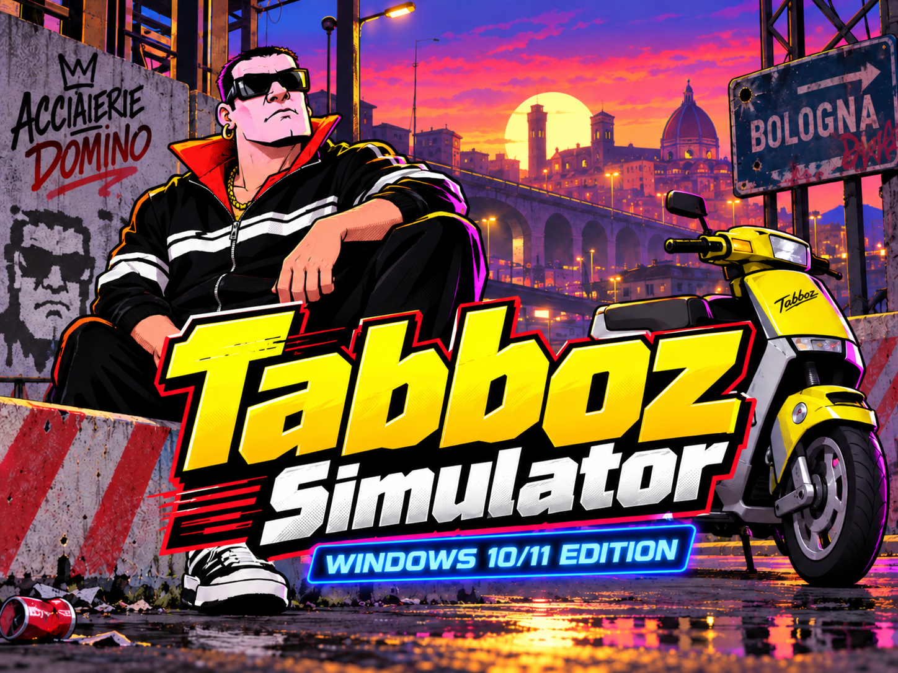

# Tabboz Simulator — Windows Edition

Porting nativo in C del [Tabboz Simulator originale](https://github.com/andreax79/tabboz) per **Windows 10 (1903+) e Windows 11 x64**.

Il motore, i personaggi, i suoni, le attivita' e il tono del gioco originale restano riconoscibili. Questa edizione introduce una finestra ridimensionabile, controlli Windows moderni, scorciatoie da tastiera, salvataggi nella cartella utente e **importi in euro con centesimi**, mantenendo l'economia interna originale.

## Giocare

Usare l'installer `TabbozSimulator-2.0.0-Windows-x64-Setup.exe` oppure estrarre lo ZIP portabile e avviare `Tabboz.exe`. Non servono browser, BWCC.DLL, compilatori o runtime aggiuntivi.

Gli artefatti delle build automatiche sono nella sezione [Actions](https://github.com/luca-iannelli/tabboz-v2/actions/workflows/windows.yml). Non sono firmati digitalmente.

- **Ctrl+N**: nuova partita.
- **Ctrl+O**: apri una partita `.tbz`.
- **Ctrl+S**: salva la partita corrente.
- **File → Salva con nome**: esporta una partita.
- **Tab**, **Invio**, **Esc** e i tasti **Alt**: navigazione delle finestre.

Le attivita' fanno avanzare il gioco secondo le regole originali. L'opzione degli eventi mentre la finestra e' ridotta a icona conserva il comportamento del timer originale.

I salvataggi sono in `%LOCALAPPDATA%\Tabboz Simulator\`. Anche la versione portabile separa i dati dall'eseguibile. La disinstallazione conserva le partite. I file non validi vengono conservati per recupero; se una scrittura fallisce, e' possibile riprovare, esportare altrove o uscire senza salvare.

## Sviluppo e verifica

- [Compilare da Windows o WSL](docs/BUILD_WINDOWS.md)
- [Verifiche eseguite e limiti](docs/VALIDATION.md)
- [Progetto approvato](docs/superpowers/specs/2026-10-29-windows-native-design.md)
- [Analisi originale con REA](docs/research/2026-10-29-original-windows-assessment.md)
- [Stato del progetto](PROJECT_STATE.md)

Il codice originale e la sua storia Git sono conservati. Le modifiche di portabilita' correggono i callback a 64 bit e sostituiscono i controlli Borland; le formule e i cataloghi di gioco sono mantenuti. Il caricamento non ripete piu' gli effetti di una giornata e non reimposta una partita dopo il primo avvio.

## Crediti e licenza

Gioco originale (C) 1997–2001 **Andrea Bonomi, Emanuele Caccialanza, Daniele Gazzarri e collaboratori**. Baseline: `andreax79/tabboz` commit `142fa7de71fe3d4700fa0027f18d45c6ccdaa9be`.

Nuovo splash e icona forniti da **Luca Iannelli**. Le immagini originali dei personaggi restano incluse.

Codice distribuito sotto **GNU GPL versione 3 o successiva**; vedere [LICENSE](LICENSE). Le attribuzioni originali restano nei sorgenti. Questa edizione non usa le vecchie librerie BWCC presenti nel materiale storico del repository.
